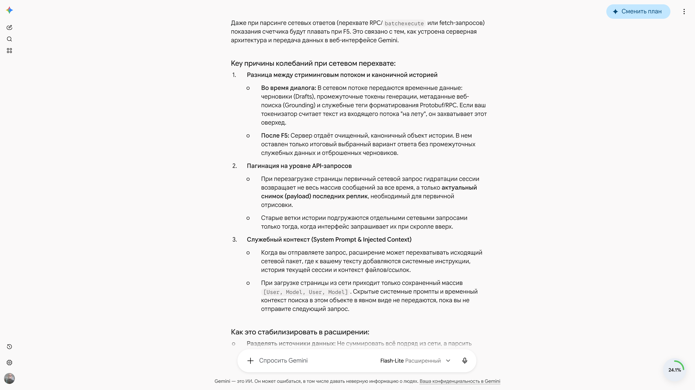
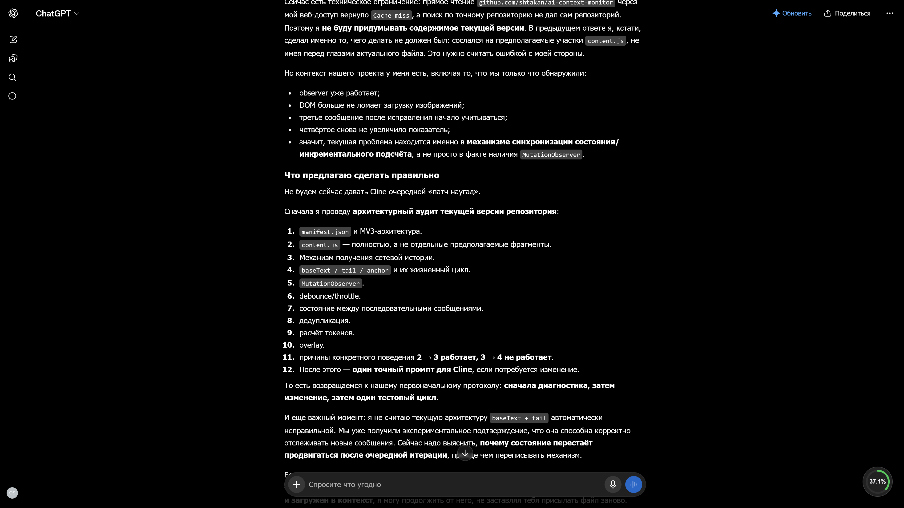
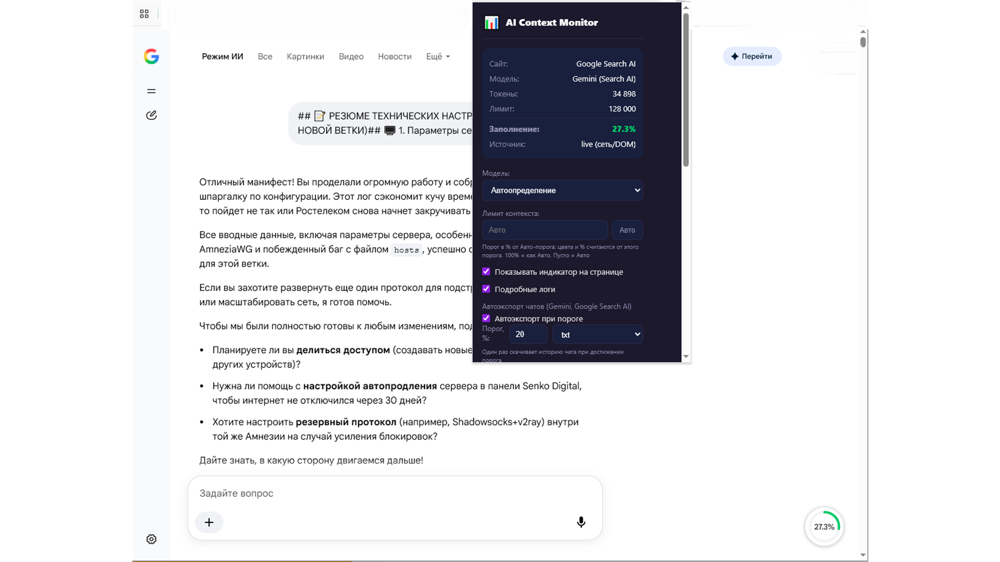
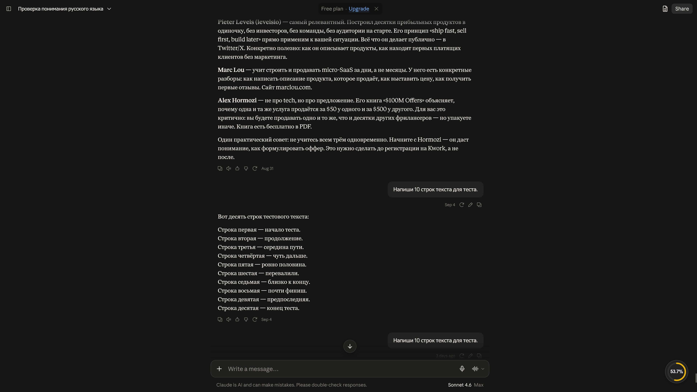
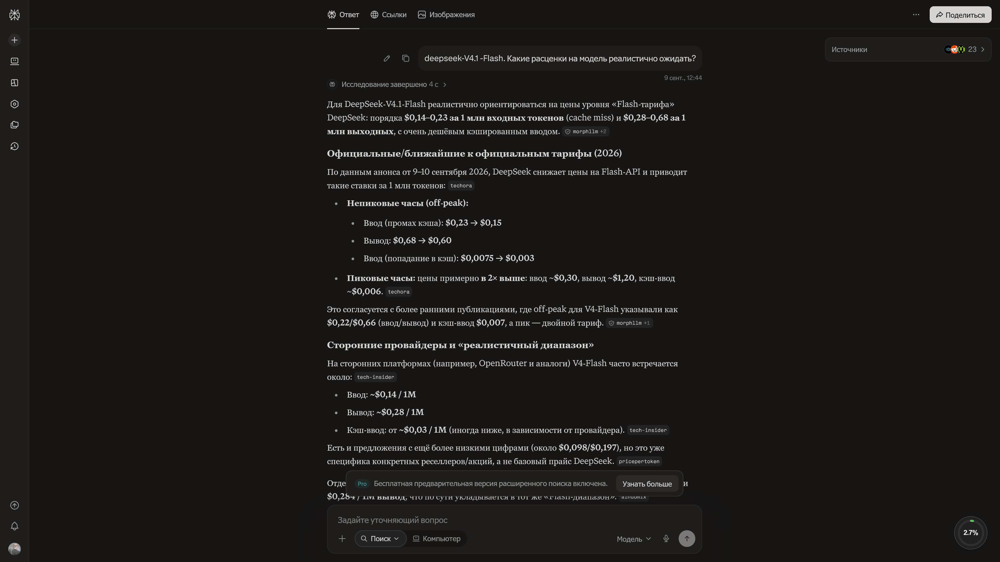

# AI Context Monitor
**Русский** | [English](README.en.md)

Расширение для Chrome и Microsoft Edge (Chromium) (Manifest V3), которое в реальном времени показывает, насколько заполнено контекстное окно AI в вашем диалоге, — на шести платформах. Когда чат становится слишком длинным, модели начинают терять детали — AI Context Monitor предупреждает об этом заранее и может автоматически сохранить весь диалог.

## Ручная установка

Расширение распространяется без магазина (публикация в Edge Add-ons отложена). Основной канал — GitHub Releases.

1. Скачайте архив `ai-context-monitor-v2.0.19.zip` со страницы релиза: <https://github.com/shtakan/ai-context-monitor/releases/tag/v2.0.19>
2. Распакуйте архив в любую папку.
3. **Microsoft Edge**: откройте `edge://extensions`, включите **«Режим разработчика»**, нажмите **«Загрузить распакованное расширение»** и выберите папку распаковки.
4. **Google Chrome**: откройте `chrome://extensions` и выполните те же действия.

> **Обновление**: скачайте новый ZIP и повторите шаги 2–4, либо нажмите «Обновить» (Reload) на плитке расширения на странице управления расширениями.

Расширение полностью открыто ([исходный код](../../tree/main)): магазин не обязателен, вы всегда можете собрать и установить его вручную из репозитория.

## Возможности

- **6 поддерживаемых платформ**: Google Gemini, ChatGPT, DeepSeek, Claude, Perplexity, Google AI Search.
- **Бейдж заполнения в реальном времени**: живой виджет в углу экрана показывает заполнение контекста (%, токены / лимит, имя модели) и обновляется по ходу переписки.
- **Автоэкспорт при достижении порога**: когда заполнение доходит до заданного порога, вся история чата автоматически скачивается в формате `txt`/`md` — один раз на чат и только после загрузки полной истории.
- **Reasoning DeepSeek в экспорте**: DeepSeek возвращает фрагменты цепочки рассуждений (`THINK`) вместе с ответом, поэтому экспортированный ход DeepSeek сохраняет и то и другое — `[REASONING] … [ANSWER] …`. Ходы без reasoning (и все остальные платформы) сохраняют прежний формат экспорта без изменений.
- **Невидимый загрузчик полной истории**: подгружает весь диалог в фоне — прокручивать вручную не нужно.
- **100% на стороне клиента**: без аккаунтов, без серверов, без телеметрии. Всё работает локально в вашем браузере.
- **Опциональный точный подсчёт токенов** через официальный API Gemini `countTokens` с вашим собственным ключом (BYOK).

## Установка

1. Скачайте ZIP со страницы [релизов](../../releases).
2. Распакуйте его в любую папку.
3. Откройте `chrome://extensions` в Chrome.
4. Включите **режим разработчика** (переключатель в правом верхнем углу).
5. Нажмите **«Загрузить распакованное расширение»** и выберите папку распаковки.

## Microsoft Edge (Chromium)

Расширение рассчитано на Manifest V3 и использует только кроссбраузерные API `chrome.*`, поэтому работает без изменений в Microsoft Edge, построенном на том же движке Chromium. Офлайн-руководство (`docs/index.html`) и скриншоты входят в пакет, поэтому ссылка **Помощь / Help** в подвале настроек работает сразу после установки.

Установка как распакованного расширения:

1. Скачайте ZIP со страницы [релизов](../../releases) и распакуйте его в любую папку.
2. Откройте `edge://extensions` в Microsoft Edge.
3. Включите **режим разработчика** (переключатель в левой боковой панели).
4. Нажмите **«Загрузить распакованное расширение»** и выберите папку распаковки.

Публикация в магазине [Microsoft Edge Add-ons](https://microsoftedge.microsoft.com/addons) запланирована; до этого момента поддерживаемый путь для Edge — установка распакованного расширения, описанная выше.

## Быстрый старт

1. Нажмите на иконку расширения, чтобы открыть попап.
2. Задайте **порог автоэкспорта** (50–99% контекстного окна) и формат экспорта (`txt` или `md`).
3. Включите **подробные логи**, если для диагностики нужен детальный вывод в консоль.
4. *(Опционально)* Вставьте свой **API-ключ Gemini** (BYOK), чтобы переключиться с локальной оценки на точный подсчёт токенов через `countTokens`.

## Архитектура

Гибридный конвейер сбора данных:

```
MAIN world interceptors (fetch/XHR)
        |  CustomEvents
        v
ISOLATED content script  -->  badge / auto-export / invisible loader
        |
        v
service worker (core/background.js)
```

- Адаптеры платформ (`adapters/*`) перехватывают сетевые ответы в MAIN-мире и передают полные сетевые снимки через CustomEvents в контент-скрипт ISOLATED (`core/content.js`), который хранит состояние, отрисовывает бейдж, запускает автоэкспорт и выполняет невидимый загрузчик истории; фоновые задачи обрабатывает service worker.
- Сборка текста экспорта находится в `utils/export-text-builders.js`; построение справочного/контекстного текста — в `utils/buildReferenceText.js`.

## Тесты

```bash
npm test
```

Запускает Jest — **as of v2.0.19 (2026-10-21): 179 suites / 3171 tests**, зелёный в CI. Счётчики — это датированный снимок дерева v2.0.19; актуальные числа — те, что печатает `npm test` в строке `Tests: ... total`. Обезличенные фикстуры лежат в `tests/fixtures`. Личные («живые») снятые сэмплы исключены через gitignore — тесты, которым они нужны, автоматически пропускаются, если этих файлов нет.

## Приватность

Всё остаётся локально: без телеметрии, без аналитики, без сбора данных. Единственные исходящие запросы идут к самим чат-сайтам и, опционально, к API Gemini с вашим собственным ключом. Ваш BYOK-ключ хранится только в `chrome.storage` на вашей машине.

Полная политика входит в пакет расширения и открывается офлайн из подвала настроек: [privacy/privacy.html](privacy/privacy.html).

## Скриншоты

Пять живых снимков, по одному на платформу, лежат в [`docs/screenshots/`](docs/screenshots/). Те же файлы входят в релизный ZIP и отображаются офлайн-руководством в `docs/index.html`.

**Gemini — жёлтая зона (более 50%)**



**ChatGPT — красная зона (более 80%)**



**Попап Google Search AI — бейдж и попап расширения**



**Claude — индикатор контекста (Sonnet / Opus / Haiku, окно 200K)**



**Perplexity — перехват треда и потока ответов (Sonar / Sonar Pro)**



## Известные ограничения

- **Сторонние перехватчики на той же странице.** Если другое расширение на той же вкладке тоже подменяет `fetch` / `XMLHttpRequest` (например, DeepSeek++ или All API Hub на chat.deepseek.com), два слоя перехвата конкурируют за один и тот же сетевой поток. Симптомы различаются — пропущенные ходы, искажённые фрагменты, несовпадение ролей — и зависят от порядка загрузки, которым это расширение не управляет. **Обходной путь**: оставьте ai-context-monitor единственным расширением, перехватывающим сеть, на отслеживаемой вкладке — либо отключите другие перехватчики на время экспорта.
- **Обрезка истории на стороне сервера в Google Search AI (GSA).** GSA может незаметно обрезать тред на сервере (наблюдалось: 59 → 6 сообщений). Расширение считает ровно то, что возвращает сервер; восстановить уже отброшенные сервером сообщения оно не может.

## Отказ от ответственности

Проект не связан с Google, OpenAI, Anthropic, DeepSeek, Perplexity или любой другой упомянутой компанией, не одобрен и не спонсируется ими. Все названия продуктов и товарные знаки принадлежат их соответствующим владельцам.

## Лицензия

[MIT](LICENSE)

## 🎥 Демо

Посмотрите AI Context Monitor в действии:

[](docs/videos/ai-context-monitor-demo-v2.0.13.mp4)

*Примечание: если видео не воспроизводится прямо на GitHub, его можно [скачать здесь](https://github.com/shtakan/ai-context-monitor/raw/main/docs/videos/ai-context-monitor-demo-v2.0.13.mp4).*
